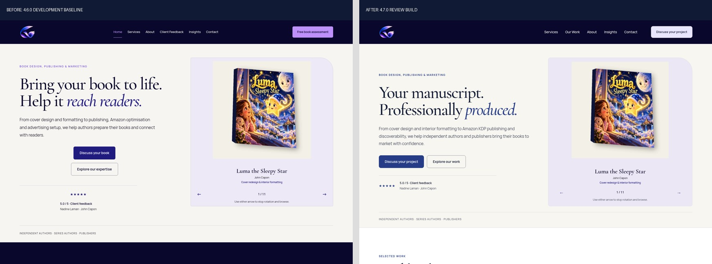
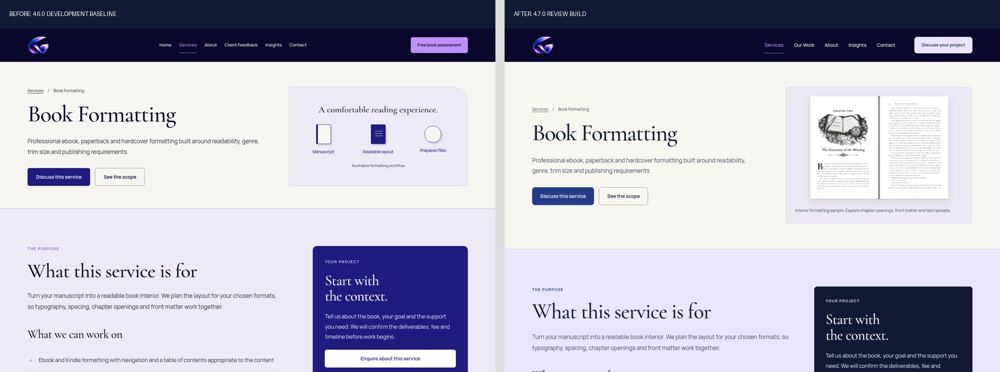
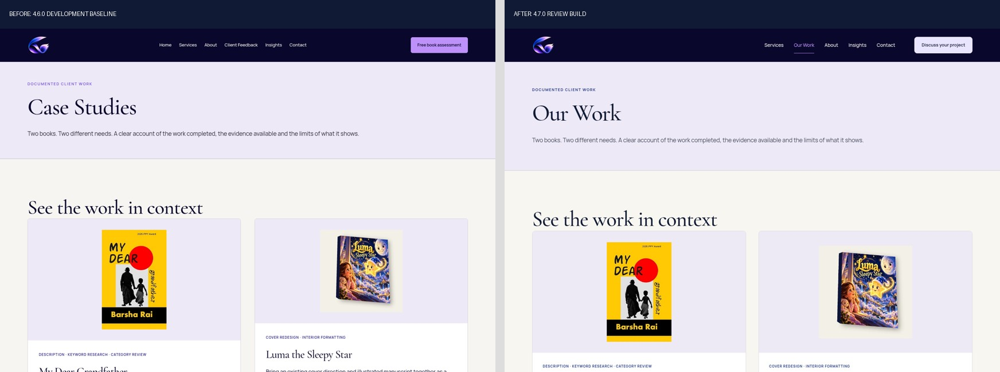
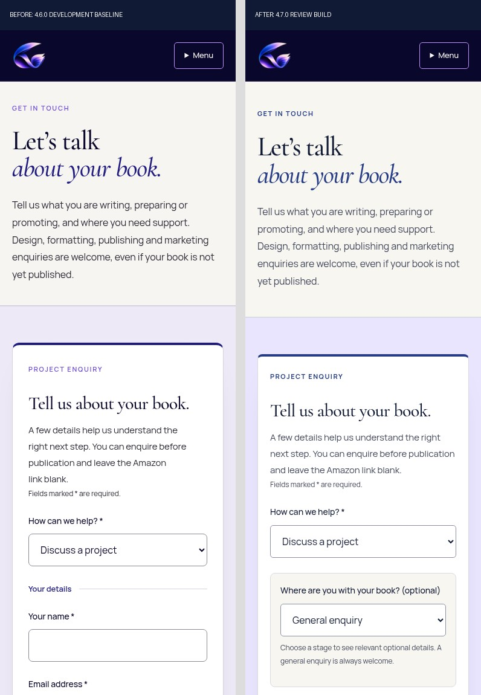

# Before and after: 4.7.0 review build

These are actual Chromium screenshots from the isolated WordPress/Elementor/Yoast installation. “Before” is the 4.6.0 development baseline; “after” is the 4.7.0 review build. They are not screenshots of a production deployment.

## Homepage

[Before, full desktop page](evidence/screenshots/before-home-1440.png) · [After, full desktop page](evidence/screenshots/after-home-1440.png) · [After, full mobile page](evidence/screenshots/after-home-390.png) · [Tablet](evidence/screenshots/after-home-768.png) · [1920px](evidence/screenshots/after-home-1920.png)

## Book Formatting

[Before desktop](evidence/screenshots/before-book-formatting-1440.png) · [After desktop](evidence/screenshots/after-book-formatting-1440.png) · [After mobile](evidence/screenshots/after-book-formatting-390.png)

## Our Work

[Before desktop](evidence/screenshots/before-case-studies-1440.png) · [After desktop](evidence/screenshots/after-case-studies-1440.png) · [After mobile](evidence/screenshots/after-case-studies-390.png) · [Tablet](evidence/screenshots/after-case-studies-768.png)

## Contact

[After desktop](evidence/screenshots/after-contact-1440.png) · [After mobile](evidence/screenshots/after-contact-390.png) · [Tablet](evidence/screenshots/after-contact-768.png)

The form starts with a general enquiry. Choosing a project stage reveals only its relevant optional fields; this interactive behaviour is covered by the browser checks.

## Further pages

[Services before](evidence/screenshots/before-services-1440.png) · [Services after](evidence/screenshots/after-services-1440.png) · [Services mobile](evidence/screenshots/after-services-390.png)

[About before](evidence/screenshots/before-about-1440.png) · [About after](evidence/screenshots/after-about-1440.png) · [About mobile](evidence/screenshots/after-about-390.png)

Full-page images are tall. Open the linked file at its original size to inspect typography, image detail and lower sections. The complete 26-page/six-width results are retained in [browser.json](evidence/browser.json).
